<div align="center">

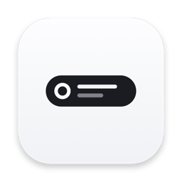

# YOMO

**Y**ou **O**nly **M**enu **O**nce

*单进程、单菜单栏入口、零第三方依赖的原生 macOS 模块化实用工具箱*

[](https://www.apple.com/macos/)
[](https://swift.org/)
[](#为什么选择-yomo)
[](#快速开始)
[](#开源协议)

**简体中文** · [English](README_EN.md)

[核心特性](#为什么选择-yomo) · [菜单栏样式](#菜单栏状态徽章) · [模块与示例](#八大核心模块与使用示例) · [快速开始](#快速开始) · [常见问题](#常见问题)

<br />

<table>
  <tr>
    <td align="center" width="38%">
      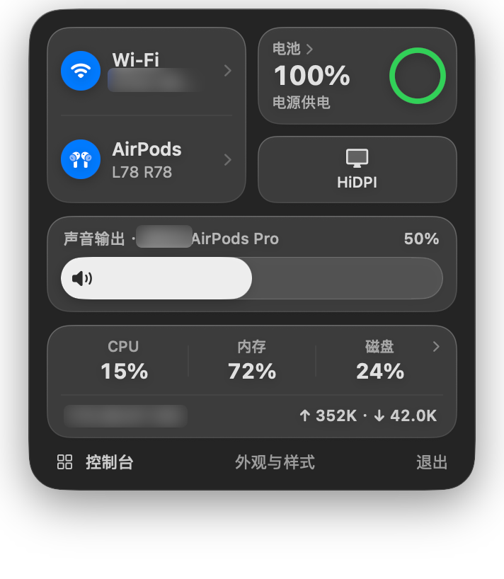
      <br />
      <sub><b>Liquid Glass 玻璃浮窗</b> · 支持 120Hz 自由拖拽排序与 1x/2x/4x 卡片缩放</sub>
    </td>
    <td align="center" width="62%">
      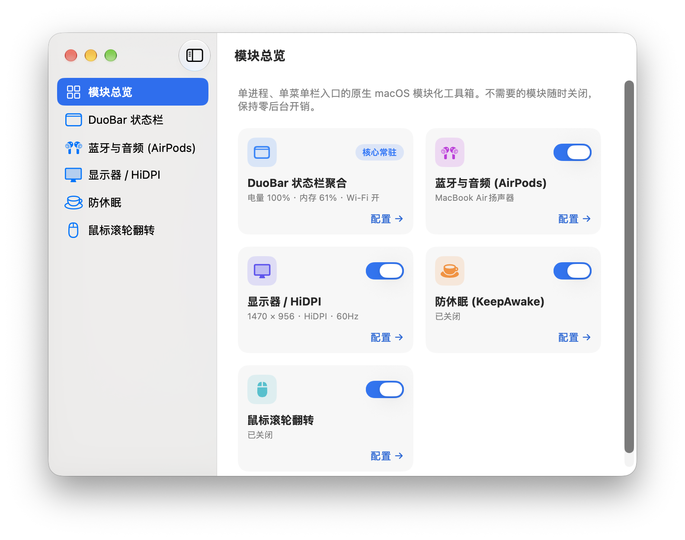
      <br />
      <sub><b>浮动侧边栏总控台</b> · 现代卡片式设计，模块按需启停、关闭即零后台开销</sub>
    </td>
  </tr>
</table>

</div>

---

## 为什么选择 YOMO？

MacBook 刘海屏让菜单栏寸土寸金。为了看一眼网速、内存、AirPods 电量、切一下外接屏 HiDPI 或临时防休眠，很多人不得不同时常驻 5～6 个第三方菜单栏软件——不仅挤爆刘海，还会带来多个常驻进程、频繁轮询与不必要的内存/电量消耗。

**YOMO（You Only Menu Once）** 的设计理念非常简单：**用一个原生图标、一个轻量进程，干净利落地解决 macOS 日常高频痛点。**

| 对比维度 | 传统多软件拼装 | YOMO |
| :--- | :--- | :--- |
| **菜单栏占用** | 5～6 个独立图标，极易被刘海遮挡 | **仅 1 个紧凑矢量徽章**，4 种样式随心切换 |
| **进程与依赖** | 多进程常驻，常含 Electron / 第三方库 | **单进程纯原生 Swift**（AppKit + SwiftUI），**零第三方依赖** |
| **底层采集方式** | 频繁派生 `ps` / `system_profiler` / `caffeinate` 子进程 | **100% 原生系统 API**（IOKit / CoreAudio / IOBluetooth / CoreWLAN / MonitorPanel） |
| **静默能耗控制** | 后台定时轮询 + 持续刷新 UI 视图树 | **事件驱动 + 隐身零空转**：浮窗未打开时不刷新 SwiftUI，息屏自动暂停采样 |
| **视觉体验** | 风格割裂，新旧系统适配不一 | **原生 Liquid Glass 玻璃浮窗**（macOS 26+ 原生 `NSGlassEffectView`，macOS 14–15 自动降级毛玻璃） |
| **构建门槛** | 通常要求完整安装数 GB 的 Xcode | **仅需 Command Line Tools**，一行脚本即可编译打包 `.app` |

---

## 菜单栏状态徽章

YOMO 将电量、Wi-Fi 信号、CPU/内存占用与实时网速压缩进单个高清晰矢量徽章中，支持 **4 种布局样式**、**语义配色模式**（充电绿、低电量红、低电量模式橙、内存压力对齐内核状态）以及**自适应纯单色模板**：

<div align="center">
  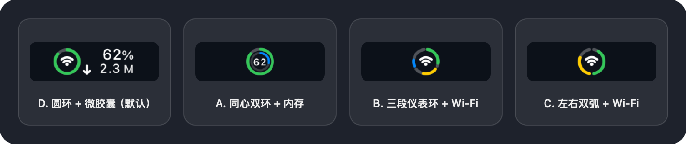
</div>

- **D. 圆环 + 微胶囊（默认）**：左侧电池外环 + Wi-Fi 信号中心图标，右侧双行直读内存占用与实时主网速（自动识别上传/下载方向）。
- **A. 同心双环 + 内存**：极致紧凑单图标——外环电量、内环 CPU、中心直读内存百分比。
- **B. 三段仪表环 + Wi-Fi**：三段弧分别映射电量、CPU 与内存水位，中心展示 Wi-Fi 状态。
- **C. 左右双弧 + Wi-Fi**：极简对称双弧设计，轻盈融入原生菜单栏。

---

## 八大核心模块与使用示例

所有扩展模块均可在「**控制台 → 模块总览**」中独立开关。不需要的模块关闭后不会参与面板渲染或刷新。

### 1. DuoBar 状态栏聚合与系统遥测

<table>
  <tr>
    <td width="38%" align="center">
      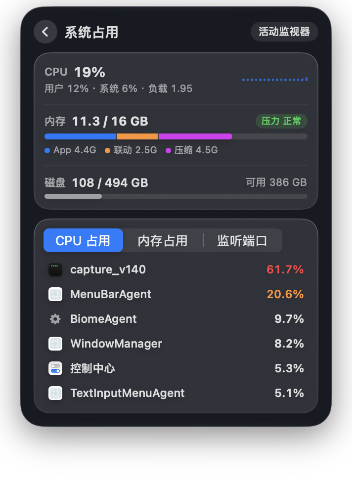
    </td>
    <td width="62%" valign="top">
      <p><b>核心能力</b></p>
      <ul>
        <li><b>实时硬件概览</b>：CPU 占用与实时波形图、系统负载、内存分段水位（App / 联动 / 压缩）与内核内存压力状态、磁盘可用空间、局域网 IP 与上下行网速。</li>
        <li><b>按需 Top 进程榜 &amp; 监听端口雷达</b>：仅在打开「系统占用」二级页时采样 CPU / 内存占用 Top 进程，并内置原生<b>监听端口雷达</b>——支持搜索本地监听端口与对应进程、一键安全终止普通进程，root 进程支持一键复制 <code>sudo</code> 终止命令，并可一键跳转系统「活动监视器」。</li>
        <li><b>Wi-Fi 快捷管理</b>：查看当前频段（2.4G / 5G / 6G）、RSSI 信号强度与协商速率，支持开关 Wi-Fi 与按需扫描连接附近网络。</li>
        <li><b>电池深度信息</b>：展示电池健康度、循环次数、供电功率与预计剩余时间，一键切换低电量模式。</li>
      </ul>
      <p><b>使用示例</b></p>
      <blockquote>
        电脑突然风扇起飞或卡顿？点一下菜单栏图标 → 点击底部「CPU / 内存 / 磁盘」卡片 → 秒看是哪个进程在吃 CPU 或内存，无需每次打开笨重的活动监视器。
      </blockquote>
    </td>
  </tr>
</table>

---

### 2. 蓝牙与音频（AirPods 专属优化）

<table>
  <tr>
    <td width="38%" align="center">
      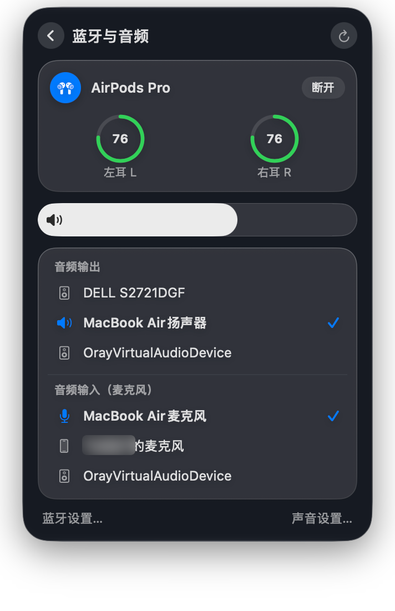
    </td>
    <td width="62%" valign="top">
      <p><b>核心能力</b></p>
      <ul>
        <li><b>AirPods 真实分体电量</b>：原生毫秒级（&lt; 0.5ms）读取左耳 / 右耳 / 充电盒真实电量，零子进程。</li>
        <li><b>蓝牙设备一键连断</b>：直接在浮窗内连接或断开已配对蓝牙耳机/外设，无需钻进系统设置。</li>
        <li><b>CoreAudio 输出/输入秒切</b>：独立切换默认音频输出与麦克风输入设备，不篡改系统提示音设备；自带原生触感胶囊音量滑动条与一键静音。</li>
        <li><b>防蓝牙通话降质</b>：会议软件调用 AirPods 麦克风触发 HFP 协议导致音乐变糊？一键锁定「MacBook 内建麦克风」，瞬间恢复高保真立体声。</li>
      </ul>
      <p><b>使用示例</b></p>
      <blockquote>
        开着会议同时听歌、或者连接蓝牙耳机发现音质突然变差：展开 YOMO → 进入「蓝牙与音频」→ 将输入麦克风切回「内建麦克风」，耳机立刻恢复高清音质。
      </blockquote>
    </td>
  </tr>
</table>

---

### 3. 显示器 / HiDPI 与高刷秒切

<table>
  <tr>
    <td width="38%" align="center">
      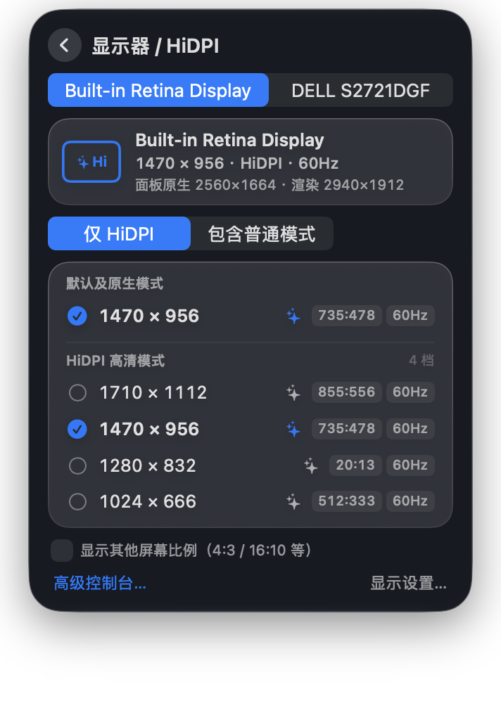
    </td>
    <td width="62%" valign="top">
      <p><b>核心能力</b></p>
      <ul>
        <li><b>原生多屏引擎</b>：直连 macOS 系统原生显示引擎，无需创建虚拟屏或修改系统配置。</li>
        <li><b>HiDPI &amp; 刷新率秒切</b>：清晰标注面板原生像素与当前渲染分辨率，支持「仅 HiDPI / 包含普通模式」过滤、非原生比例折叠与多刷新率档位切换。</li>
        <li><b>安全回滚与丝滑重锚定</b>：切换分辨率时浮窗自动避让并在新菜单栏位置重新锚定；支持一键回滚至上一个有效模式。</li>
      </ul>
      <p><b>使用示例</b></p>
      <blockquote>
        外接 2K/4K 显示器写代码时想切高密度分辨率、录屏演示时想切回 1080p HiDPI：展开 YOMO → 点「HiDPI」卡片 → 选中对应显示器一键秒切，手滑还能随时点「撤销回滚」。
      </blockquote>
    </td>
  </tr>
</table>

---

### 4. KeepAwake 原生防休眠

<table>
  <tr>
    <td width="38%" align="center">
      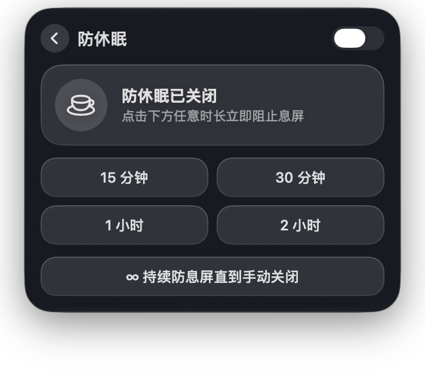
    </td>
    <td width="62%" valign="top">
      <p><b>核心能力</b></p>
      <ul>
        <li><b>内核级托管超时</b>：使用原生 <code>IOKit</code> 电源断言与内核超时机制，不派生 <code>caffeinate</code> 子进程。</li>
        <li><b>零残留、不漂移</b>：基于绝对时间戳实时倒计时；即使进程异常退出，内核也会自动释放锁屏断言，绝不留下「永远不息屏」的幽灵状态。</li>
        <li><b>多档快捷时长</b>：提供 15 分钟、30 分钟、1 小时、2 小时与「∞ 持续防息屏」五档一键触发。</li>
      </ul>
      <p><b>使用示例</b></p>
      <blockquote>
        跑长耗时构建、下载大文件或投屏演讲时不想 Mac 突然息屏断网：展开 YOMO → 点「防休眠」→ 选择「1 小时」，到点自动恢复系统默认休眠策略。
      </blockquote>
    </td>
  </tr>
</table>

---

### 5. 鼠标滚轮翻转（ScrollReverser）

<table>
  <tr>
    <td width="38%" align="center">
      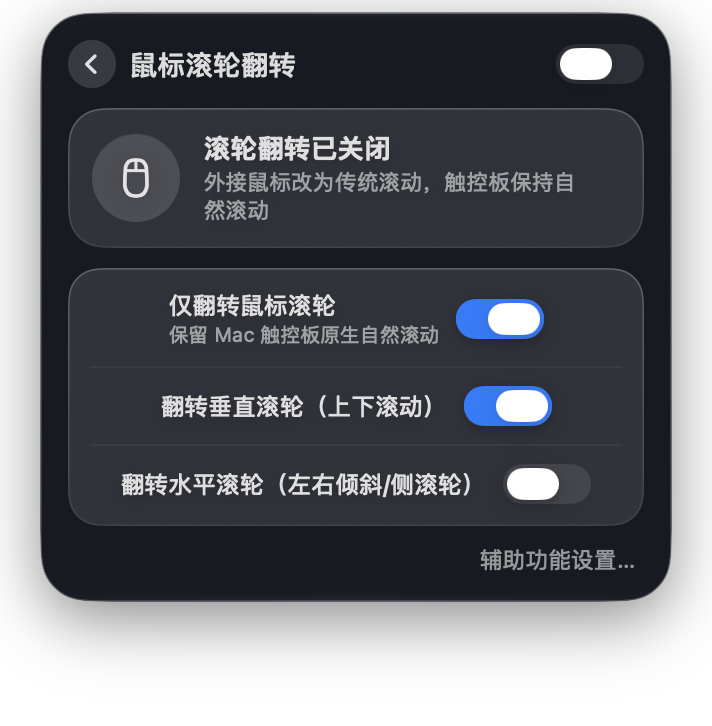
    </td>
    <td width="62%" valign="top">
      <p><b>核心能力</b></p>
      <ul>
        <li><b>鼠标与触控板独立方向</b>：基于底层 Quartz <code>CGEventTap</code> 精准区分外接鼠标滚轮与触控板手势，让外接鼠标恢复传统滚动方向，同时完整保留 Mac 触控板的自然滚动。</li>
        <li><b>垂直 / 水平独立控制</b>：支持单独开关垂直滚轮（上下滚动）与水平滚轮（左右倾斜 / 侧滚轮）翻转。</li>
        <li><b>零空转开销</b>：关闭开关或停用模块时彻底卸载 <code>CGEventTap</code>，后台 0% CPU 占用。</li>
      </ul>
      <p><b>使用示例</b></p>
      <blockquote>
        习惯了触控板「自然滚动」，但插上外接鼠标后觉得滚轮方向反了？展开 YOMO → 点「滚轮翻转」开关即可即刻生效，再也不用为这一个需求单独装第三方滚轮软件。
      </blockquote>
    </td>
  </tr>
</table>

---

### 6. 历史剪贴板 &amp; OCR（Clipboard）

<table>
  <tr>
    <td width="38%" align="center">
      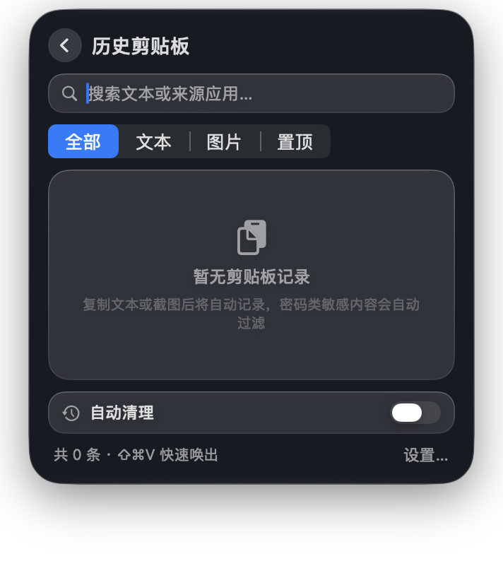
    </td>
    <td width="62%" valign="top">
      <p><b>核心能力</b></p>
      <ul>
        <li><b>全局快捷键秒呼 &amp; 空格快速预览</b>：内置零权限原生 Carbon 热键 <code>⇧⌘V</code>（Shift+Cmd+V）一步直达历史剪贴板；悬停任意图片或长文本条目按住 <b>空格键（Space）</b> 即可弹出高清原图 / 全文快速预览浮窗。</li>
        <li><b>文本与图片双记录</b>：自动记录复制的文本与截图（图片在后台线程异步编码，不卡主线程），带来源应用图标与相对时间。</li>
        <li><b>本地 Vision OCR &amp; 二维码扫描</b>：图片条目支持按需调用 Apple 原生 <code>Vision</code> 引擎一键提取图片文字（OCR）及识别二维码 / 条形码，完全离线运行。</li>
        <li><b>隐私安全过滤</b>：自动识别并跳过 1Password / Bitwarden / 系统密码等密码管理器及敏感标记（<code>ConcealedType</code> / <code>TransientType</code>），绝不记录密码。</li>
        <li><b>搜索、置顶与自动清理</b>：支持按内容或来源应用即时搜索、「全部 / 文本 / 图片 / 置顶」分类筛选、一键置顶常用片段，以及可自定义保留小时数的自动清理开关。</li>
      </ul>
      <p><b>使用示例</b></p>
      <blockquote>
        连续复制了多条终端命令、文档链接和截图，想找回刚才那一条？直接按 <code>⇧⌘V</code> → 输入关键词或点「图片 / 置顶」筛选 → 一键复原，常用命令还能直接置顶常驻。
      </blockquote>
    </td>
  </tr>
</table>

---

### 7. 键盘锁（清洁模式防误触）

<table>
  <tr>
    <td width="46%" align="center">
      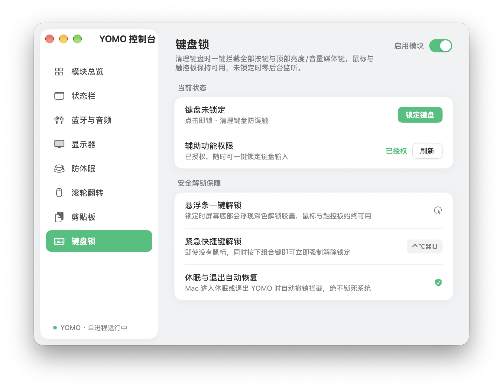
    </td>
    <td width="54%" valign="top">
      <p><b>核心能力</b></p>
      <ul>
        <li><b>全按键 + 媒体键拦截</b>：基于底层 Quartz <code>CGEventTap</code> 一键拦截所有键盘按键与顶部功能/媒体键（亮度、音量、播放等），鼠标与触控板始终保持可用。</li>
        <li><b>多道安全解锁保险</b>：支持点击屏幕底部「解锁」悬浮条 HUD、再次点击 YOMO 主面板「键盘锁」按钮、或紧急快捷键 <code>⌃⌥⌘U</code> 强制解锁；Mac 休眠或退出应用时自动解除锁定，绝不锁死系统。</li>
        <li><b>零后台开销</b>：未锁定时彻底卸载事件监听（0% CPU 占用），与「鼠标滚轮翻转」共享辅助功能权限。</li>
      </ul>
      <p><b>使用示例</b></p>
      <blockquote>
        想擦拭 MacBook 键盘灰尘，或防止家里的猫咪踩键盘乱发消息？点一下 YOMO 主浮窗里的「键盘锁」图标即可放心清理，擦完点底部悬浮条或按 <code>⌃⌥⌘U</code> 秒解锁。
      </blockquote>
    </td>
  </tr>
</table>

---

### 8. 空间清理与开机启动项（SpaceCleaner）

<table>
  <tr>
    <td width="46%" align="center">
      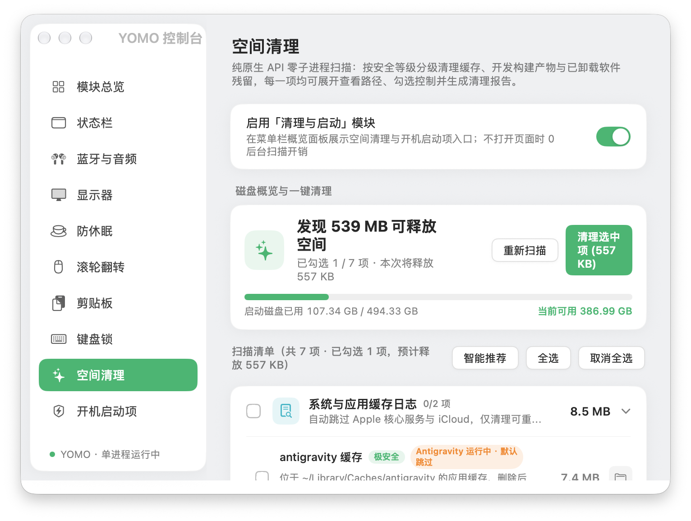
    </td>
    <td width="54%" valign="top">
      <p><b>核心能力</b></p>
      <ul>
        <li><b>零子进程分级安全清理</b>：纯原生 API 扫描系统与应用缓存、开发构建产物及已卸载软件残留，自动跳过 Apple 核心服务与正在运行的应用，每项可展开查看真实路径、逐项勾选并生成清理报告。</li>
        <li><b>开机启动项分组管理</b>：按应用分组展示 <code>launchd</code> 后台自启项的真实运行状态与应用图标，支持用户级 <code>LaunchAgents</code> 可逆一键启停、系统级守护进程按需管理员授权，并可直达系统「登录项与扩展」设置。</li>
        <li><b>按需扫描零常驻</b>：不打开清理页面时 0 后台扫描开销。</li>
      </ul>
      <p><b>使用示例</b></p>
      <blockquote>
        磁盘告急或开机后台自启软件太多？打开 YOMO 控制台 → 进入「空间清理」点「智能推荐」一键释放安全缓存与卸载残留，再切到「开机启动项」按应用把不需要的后台守护进程关掉。
      </blockquote>
    </td>
  </tr>
</table>

---

### 外观与个性化设置

<table>
  <tr>
    <td width="38%" align="center">
      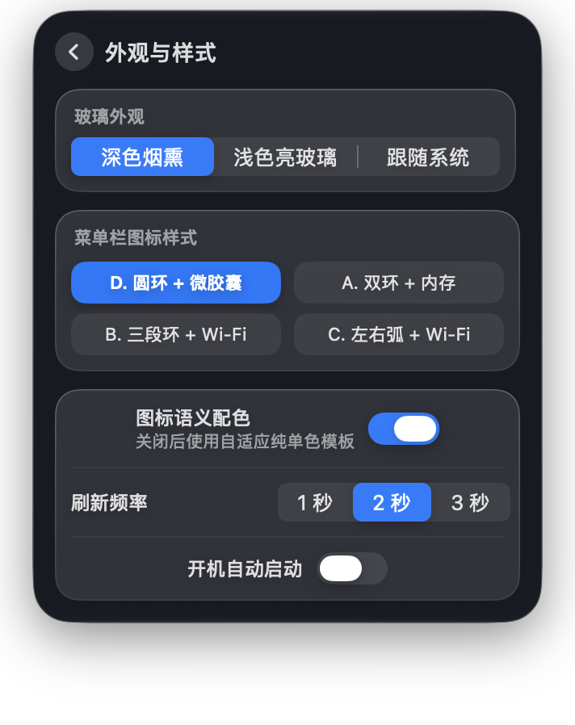
    </td>
    <td width="62%" valign="top">
      <ul>
        <li><b>自由拖拽 Bento 布局</b>：主浮窗支持 120Hz 顺滑直接拖拽排序模块卡片，进入布局模式可自由调整 <code>1x / 2x / 4x</code> 卡片尺寸并智能补齐空槽。</li>
        <li><b>三种玻璃外观</b>：支持 <code>深色烟熏</code>、<code>浅色亮玻璃</code> 与 <code>跟随系统</code> 实时切换。</li>
        <li><b>菜单栏图标定制</b>：4 种徽章样式 + 语义配色 / 纯单色模板自由组合。</li>
        <li><b>采样频率调节</b>：支持 <code>1 秒 / 2 秒 / 3 秒</code> 刷新节奏。</li>
        <li><b>开机自动启动 &amp; 原生应用内更新</b>：原生注册登录项，并内置基于 GitHub Releases 的零限流检查更新与一键原地升级（带 SHA-256 校验）。</li>
      </ul>
    </td>
  </tr>
</table>

---

## 快速开始

### 方式一：直接下载 Release 安装包（推荐）

1. 前往 [Releases 页面](https://github.com/vvkis/YOMO/releases) 下载最新版本的 **`YOMO-v1.6.2.dmg`**（同时提供 **`YOMO-v1.6.2-source.zip`** 源码归档与 `SHA256SUMS.txt` 校验文件）。
2. 双击打开 `.dmg`，将 **`YOMO.app`** 拖入 **`Applications`（应用程序）** 文件夹。
3. 打开 **YOMO**，在浮窗底部点击 **「外观与样式」→ 开启「开机自动启动」**，即可随系统静默常驻。

> [!NOTE]
> **首次打开提示「无法验证开发者 / 已损坏」怎么办？**
> 由于本项目为免费开源软件、当前采用本地自签名（未经过 Apple 公证），首次从网络下载运行时 macOS Gatekeeper 可能会拦截。在终端执行一行命令移除隔离属性即可正常打开：
> ```bash
> xattr -cr /Applications/YOMO.app
> ```

### 方式二：从源码构建

- **系统版本**：macOS 14.0 (Sonoma) 及以上（支持 Apple Silicon 与 Intel）
- **编译工具**：仅需安装 **Xcode Command Line Tools**（Swift 5.10+），**无需安装完整 Xcode**

如尚未安装 Command Line Tools，可执行：

```bash
xcode-select --install
```

编译运行或自行打 Release 包：

```bash
# 1. 克隆仓库
git clone https://github.com/vvkis/YOMO.git
cd YOMO

# 2. 编译 Release 版本并打包为标准 .app
./scripts/build-app.sh
open dist/YOMO.app

# 3.（可选）一键生成 DMG 安装包 + 干净源码 ZIP + SHA256 校验文件
./scripts/build-release.sh
# 产物输出至 dist/YOMO-v1.6.2.dmg、dist/YOMO-v1.6.2-source.zip、dist/SHA256SUMS.txt
```

### 首次运行权限说明

YOMO 为 **100% 本地离线应用**，不包含任何遥测上报或网络请求。部分系统级信息受 macOS 隐私机制保护，仅在你需要对应功能时按需授权：

| 权限 | 用途 | 是否必需 |
| :--- | :--- | :--- |
| **定位服务（Location）** | macOS 14+ 要求定位权限才能读取当前 Wi-Fi 名称（SSID）与扫描附近网络 | 可选（不授权仍可正常查看信号强度与网速） |
| **蓝牙（Bluetooth）** | 读取已配对蓝牙设备状态与 AirPods 电量、执行一键连断 | 使用蓝牙模块时需要 |
| **辅助功能（Accessibility）** | 翻转外接鼠标滚轮事件（不影响触控板），或清洁模式锁定键盘按键 | 仅使用「鼠标滚轮翻转」或「键盘锁」模块时需要 |

---

## 常见问题

<details>
<summary><b>1. 为什么 Wi-Fi 显示已连接，但看不到 Wi-Fi 名称（SSID）？</b></summary>
<br />
从 macOS 14 (Sonoma) 开始，Apple 将当前 Wi-Fi SSID 归类为位置隐私信息，未授权定位权限时系统会直接返回 <code>nil</code>。请在 YOMO 的「Wi-Fi」二级页点击 <b>「授权」</b>，或在「系统设置 → 隐私与安全性 → 定位服务」中勾选 <b>YOMO</b> 即可立即显示。
</details>

<details>
<summary><b>2. 为什么不需要安装完整 Xcode 就能编译？</b></summary>
<br />
YOMO 采用纯 SwiftPM 工程组织，不依赖仅随完整 Xcode 分发的组件，因此在仅安装 Command Line Tools 的轻量开发机上也能直接编译打包。
</details>

<details>
<summary><b>3. 关掉不需要的模块，真的不会占用后台资源吗？</b></summary>
<br />
是的。在「控制台 → 模块总览」中关闭某个模块后，主浮窗会隐藏对应入口且打开浮窗时不会触发该模块的刷新逻辑；关闭「防休眠」模块还会立即释放当前持有的防休眠锁。
</details>

<details>
<summary><b>4. 如何完全卸载 YOMO？</b></summary>
<br />
先在 YOMO 中关闭「开机自动启动」并退出应用，然后删除 <code>/Applications/YOMO.app</code>。如需同时彻底清理偏好设置、历史剪贴板数据与全部系统缓存，可运行：
<pre><code>defaults delete com.yomo.suite 2&gt;/dev/null || true
rm -rf \
  "$HOME/Library/Application Support/YOMO" \
  "$HOME/Library/Caches/com.yomo.suite" \
  "$HOME/Library/HTTPStorages/com.yomo.suite" \
  "$HOME/Library/Saved Application State/com.yomo.suite.savedState"</code></pre>
</details>

---

## 参与贡献

欢迎提交 Issue 反馈 Bug 或建议，也非常欢迎直接发起 Pull Request！

## 开源协议

本项目基于 [MIT License](LICENSE) 开源，欢迎自由使用、修改与分发。

<div align="center">
  <br />
  <sub>如果 YOMO 让你的 Mac 菜单栏清爽了一点，欢迎点一颗 ⭐ Star！</sub>
</div>
