<div align="center">

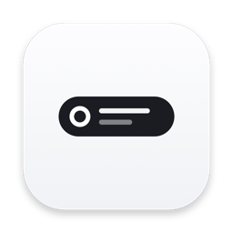

# YOMO

**Y**ou **O**nly **M**enu **O**nce

*A single-process, single-icon, zero-dependency native macOS utility suite*

[](https://www.apple.com/macos/)
[](https://swift.org/)
[](#why-yomo)
[](#quick-start)
[](#license)

[简体中文](README.md) · **English**

[Why YOMO](#why-yomo) · [Menu Bar Styles](#menu-bar-status-badge) · [Modules & Examples](#core-modules--usage-examples) · [Quick Start](#quick-start) · [FAQ](#faq)

<br />

<table>
  <tr>
    <td align="center" width="38%">
      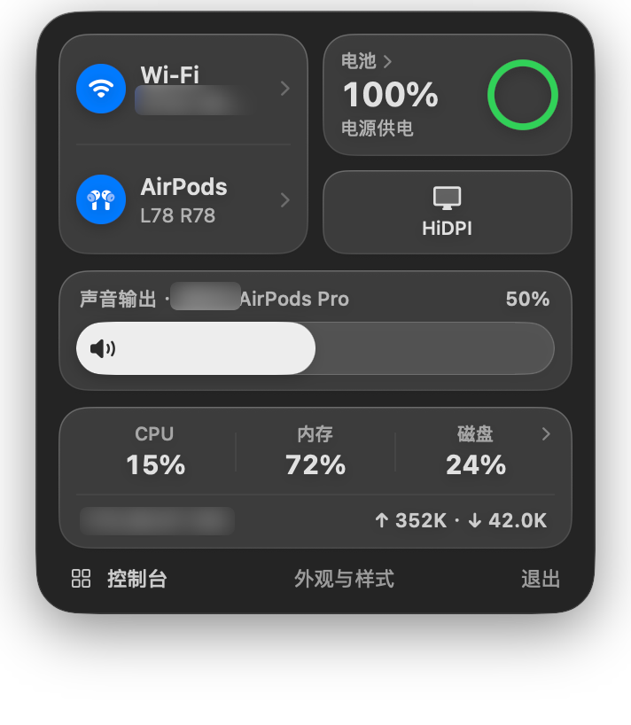
      <br />
      <sub><b>Liquid Glass Popover</b> · 120Hz drag-and-drop Bento grid with 1x / 2x / 4x tile resizing</sub>
    </td>
    <td align="center" width="62%">
      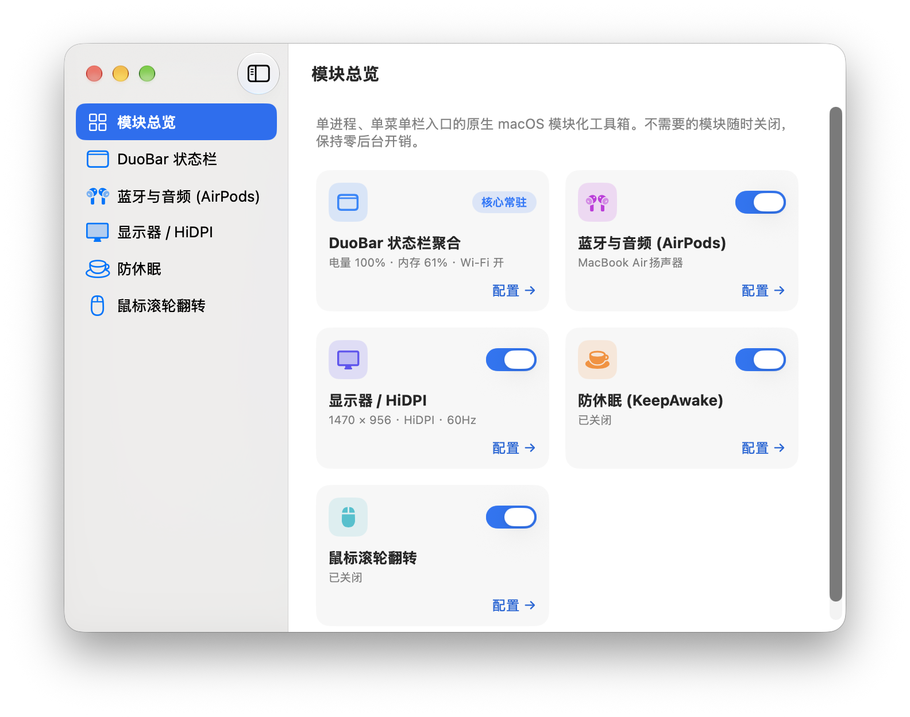
      <br />
      <sub><b>Floating-Sidebar Hub Console</b> · Modern card-based UI with on-demand module toggles</sub>
    </td>
  </tr>
</table>

</div>

---

## Why YOMO?

Menu bar space on notched MacBooks is precious. Just to glance at network speed, memory usage, AirPods battery, toggle external HiDPI modes, or keep the screen awake, many users end up running 5–6 separate menu bar apps—crowding the notch, spawning background processes, and draining battery with constant polling.

**YOMO (You Only Menu Once)** follows one simple philosophy: **one native icon, one lightweight process, solving everyday macOS friction cleanly.**

| Dimension | Traditional Multi-App Stack | YOMO |
| :--- | :--- | :--- |
| **Menu Bar Footprint** | 5–6 separate icons, easily hidden behind the notch | **1 compact vector badge** with 4 switchable styles |
| **Processes & Deps** | Multiple daemons, often Electron or heavy libraries | **Single native Swift process** (AppKit + SwiftUI), **zero third-party dependencies** |
| **System Integration** | Frequently spawns `ps`, `system_profiler`, `caffeinate` | **100% native macOS APIs** (IOKit, CoreAudio, IOBluetooth, CoreWLAN, MonitorPanel) |
| **Idle Energy Impact** | Continuous polling and background UI redraws | **Event-driven & stealth idle**: skips SwiftUI updates while closed, pauses automatically on display sleep |
| **Visual Craft** | Mismatched UI across different apps | **Native Liquid Glass Popover** (`NSGlassEffectView` on macOS 26+, automatic vibrancy fallback on macOS 14–15) |
| **Build Requirement** | Often requires a multi-GB full Xcode install | **Command Line Tools only** — build & package `.app` in one command |

---

## Menu Bar Status Badge

YOMO condenses battery level, Wi-Fi signal, CPU/memory usage, and live network throughput into a single crisp vector badge. Choose from **4 layout styles**, **semantic status colors** (charging green, low-battery red, Low Power Mode orange, kernel memory pressure), or an **adaptive monochrome template**:

<div align="center">
  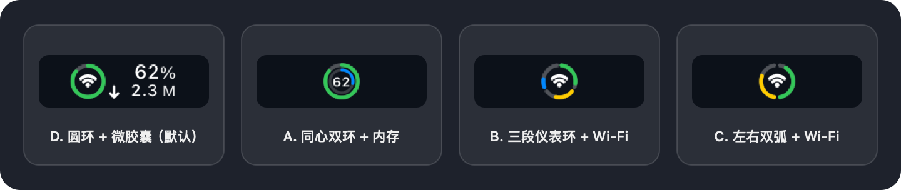
</div>

- **D. Ring + Capsule (Default)**: Battery ring + centered Wi-Fi glyph on the left; stacked memory percentage and live dominant network speed (auto upload/download arrow) on the right.
- **A. Dual Ring + Memory**: Ultra-compact single icon — outer battery ring, inner CPU ring, centered memory readout.
- **B. Tri-Arc + Wi-Fi**: Three segmented arcs mapping battery, CPU, and memory levels around a centered Wi-Fi icon.
- **C. Split Arc + Wi-Fi**: Minimalist dual-arc design that blends naturally into the native menu bar.

---

## Core Modules & Usage Examples

Every extension module can be enabled or disabled independently in **Hub Console → Modules**. Disabled modules are hidden from the popover and incur zero runtime overhead.

### 1. DuoBar Status Bar & System Telemetry

<table>
  <tr>
    <td width="38%" align="center">
      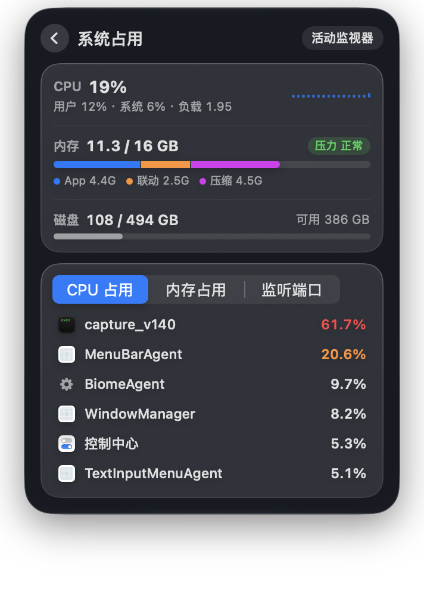
    </td>
    <td width="62%" valign="top">
      <p><b>Highlights</b></p>
      <ul>
        <li><b>Real-Time Hardware Overview</b>: CPU load &amp; sparkline, load average, segmented memory bar (App / Wired / Compressed) with kernel pressure level, disk availability, local IP, and live upload/download speeds.</li>
        <li><b>On-Demand Top Processes &amp; Listening Port Radar</b>: Samples top CPU and memory processes only while open, plus a native <b>Listening Port Radar</b> tab with live search, safe process termination, one-click <code>sudo</code> kill command copy for root services, and a shortcut to Activity Monitor.</li>
        <li><b>Quick Wi-Fi Controls</b>: View band (2.4G / 5G / 6G), RSSI, and link speed, toggle Wi-Fi power, and scan/join nearby networks on demand.</li>
        <li><b>Deep Battery Insights</b>: Battery health, cycle count, wattage, estimated time remaining, and one-click Low Power Mode toggle.</li>
      </ul>
      <p><b>Example</b></p>
      <blockquote>
        Fans suddenly spinning up? Click the menu bar badge → tap the bottom CPU/Memory/Disk tile → instantly spot the runaway process without launching Activity Monitor.
      </blockquote>
    </td>
  </tr>
</table>

---

### 2. Bluetooth & Audio (AirPods Optimized)

<table>
  <tr>
    <td width="38%" align="center">
      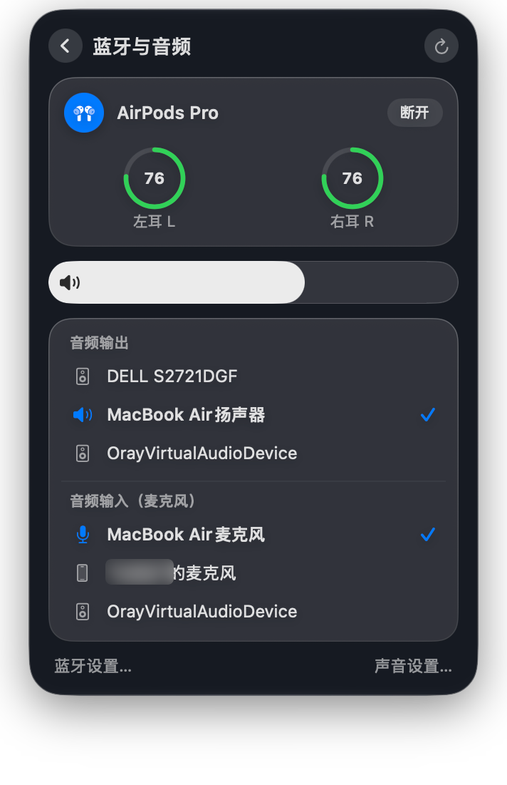
    </td>
    <td width="62%" valign="top">
      <p><b>Highlights</b></p>
      <ul>
        <li><b>True Split AirPods Battery</b>: Reads Left, Right, and Case battery percentages natively in &lt; 0.5 ms with zero subprocesses.</li>
        <li><b>One-Click Bluetooth Connect/Disconnect</b>: Pair-toggle headphones and peripherals right from the floating panel.</li>
        <li><b>Instant CoreAudio Routing</b>: Switch default output and input devices independently (without altering system alert sounds), paired with a tactile capsule volume scrubber and mute button.</li>
        <li><b>Prevent Call Quality Drop (Anti-HFP)</b>: When a call app switches AirPods to the low-bitrate HFP microphone profile, switch input back to the Built-in Mac Microphone in one tap to restore full stereo audio quality.</li>
      </ul>
      <p><b>Example</b></p>
      <blockquote>
        Audio turns muddy during a meeting with Bluetooth headphones? Open YOMO → Bluetooth &amp; Audio → select Built-in Microphone as input to restore crisp stereo playback immediately.
      </blockquote>
    </td>
  </tr>
</table>

---

### 3. Display / HiDPI & Refresh Rate Switcher

<table>
  <tr>
    <td width="38%" align="center">
      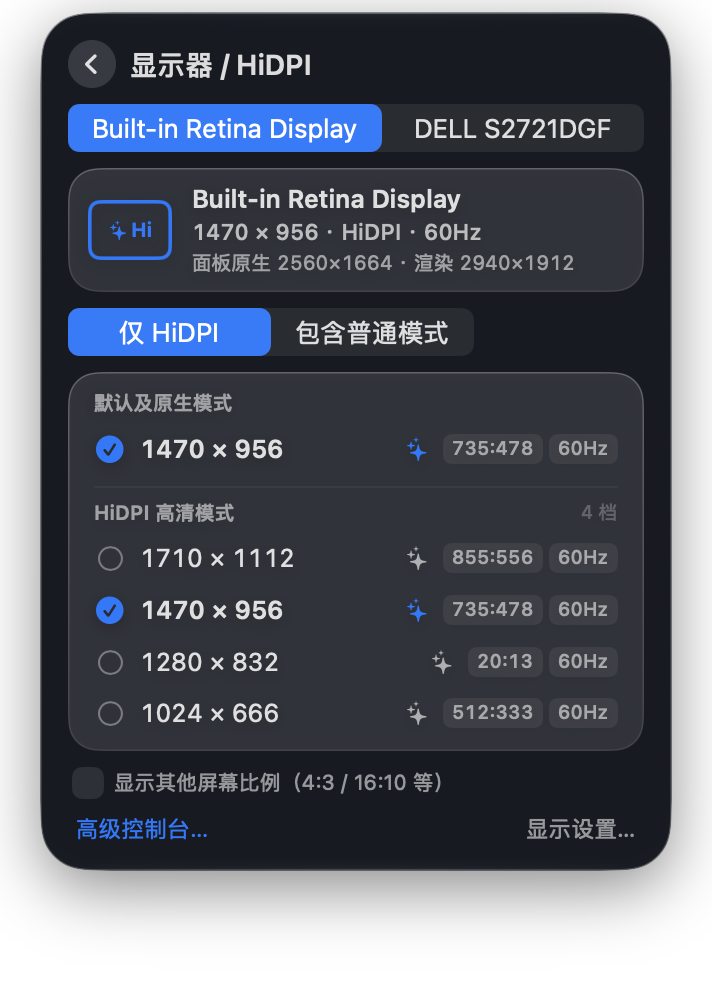
    </td>
    <td width="62%" valign="top">
      <p><b>Highlights</b></p>
      <ul>
        <li><b>Native Multi-Display Engine</b>: Bridges macOS's native display engine directly — no virtual displays or system plist hacks required.</li>
        <li><b>Instant HiDPI &amp; Refresh Rate Switching</b>: Clearly displays native panel resolution and rendered backing pixels, with HiDPI-only filtering, aspect ratio grouping, and refresh rate pills.</li>
        <li><b>Safe Rollback &amp; Smooth Re-Anchoring</b>: The floating panel gracefully hides during display reconfiguration and re-anchors neatly underneath the new menu bar position, with one-click rollback to the previous mode.</li>
      </ul>
      <p><b>Example</b></p>
      <blockquote>
        Want sharper text density on an external 2K/4K monitor for coding, or a quick switch to 1080p HiDPI for screen recording? Open YOMO → HiDPI → pick your display and switch in one click, with instant undo if needed.
      </blockquote>
    </td>
  </tr>
</table>

---

### 4. KeepAwake (Native Sleep Prevention)

<table>
  <tr>
    <td width="38%" align="center">
      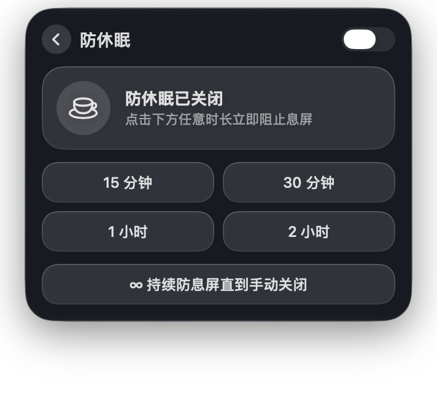
    </td>
    <td width="62%" valign="top">
      <p><b>Highlights</b></p>
      <ul>
        <li><b>Kernel-Managed Timeout</b>: Uses native <code>IOKit</code> power assertions with kernel-enforced timeouts — no <code>caffeinate</code> child process.</li>
        <li><b>Zero Leftover State</b>: Countdown runs against an absolute timestamp; even if the app exits unexpectedly, the kernel releases the assertion cleanly.</li>
        <li><b>Quick Presets</b>: 15 min, 30 min, 1 hr, 2 hr, or indefinite (∞) keep-awake in one tap.</li>
      </ul>
      <p><b>Example</b></p>
      <blockquote>
        Running a long build, downloading large files, or presenting on a projector? Open YOMO → KeepAwake → tap "1 Hour" and let macOS automatically return to normal sleep behavior when the timer ends.
      </blockquote>
    </td>
  </tr>
</table>

---

### 5. Mouse Scroll Reverser

<table>
  <tr>
    <td width="38%" align="center">
      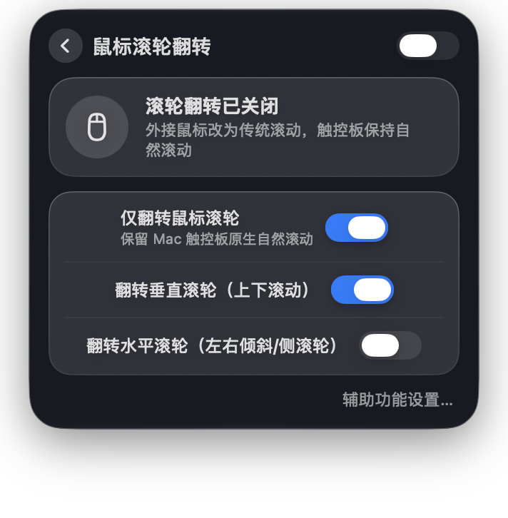
    </td>
    <td width="62%" valign="top">
      <p><b>Highlights</b></p>
      <ul>
        <li><b>Independent Mouse vs. Trackpad Direction</b>: Uses a low-level Quartz <code>CGEventTap</code> to distinguish discrete mouse scroll wheels from trackpad gestures—reversing external mouse scrolling while preserving macOS Trackpad natural scrolling.</li>
        <li><b>Separate Axis Controls</b>: Toggle vertical (up/down) and horizontal (tilt/side wheel) reversal independently.</li>
        <li><b>Zero Idle Overhead</b>: Completely tears down the <code>CGEventTap</code> when turned off or disabled (0% idle CPU).</li>
      </ul>
      <p><b>Example</b></p>
      <blockquote>
        Love natural scrolling on your MacBook trackpad, but want traditional scrolling on an external mouse? Open YOMO → toggle Scroll Reverser on in one click—no extra standalone scroll utility needed.
      </blockquote>
    </td>
  </tr>
</table>

---

### 6. Clipboard History &amp; Vision OCR

<table>
  <tr>
    <td width="38%" align="center">
      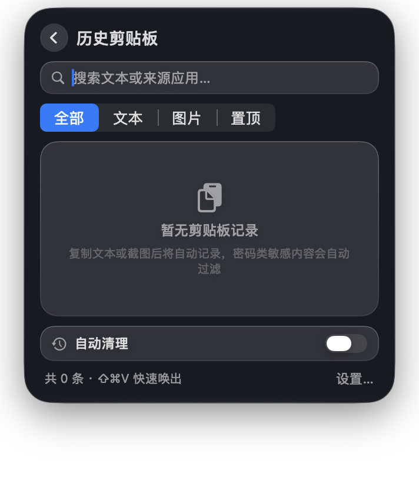
    </td>
    <td width="62%" valign="top">
      <p><b>Highlights</b></p>
      <ul>
        <li><b>Instant Global Hotkey (<code>⇧⌘V</code>) &amp; Spacebar Quick Preview</b>: Zero-permission native Carbon global shortcut jumps straight into Clipboard History from any app; hover over any image or long text entry and hold <b>Spacebar</b> for an instant floating full-size / full-text preview.</li>
        <li><b>Text &amp; Image History</b>: Automatically records copied text and screenshots (with off-main-thread PNG encoding), displaying source app icons and relative timestamps.</li>
        <li><b>On-Demand Vision OCR &amp; QR/Barcode Scanning</b>: Extract text (OCR) and scan QR/barcodes directly from any copied image using Apple's native offline <code>Vision</code> framework.</li>
        <li><b>Privacy-Aware Filtering</b>: Automatically skips sensitive pasteboard types (<code>ConcealedType</code> / <code>TransientType</code>) and password managers (Apple Passwords, 1Password, Bitwarden, KeePassXC, etc.).</li>
        <li><b>Search, Pin &amp; Auto-Cleanup</b>: Instant search by text or source app, All / Text / Image / Pinned filters, one-click pinning, and a configurable auto-cleanup timer with custom retention hours.</li>
      </ul>
      <p><b>Example</b></p>
      <blockquote>
        Copied several terminal commands, URLs, and screenshots in a row and need one from five minutes ago? Press <code>⇧⌘V</code> → filter or search → click to restore instantly, or pin frequently used snippets.
      </blockquote>
    </td>
  </tr>
</table>

---

### 7. Keyboard Lock (Cleaning Mode)

<table>
  <tr>
    <td width="46%" align="center">
      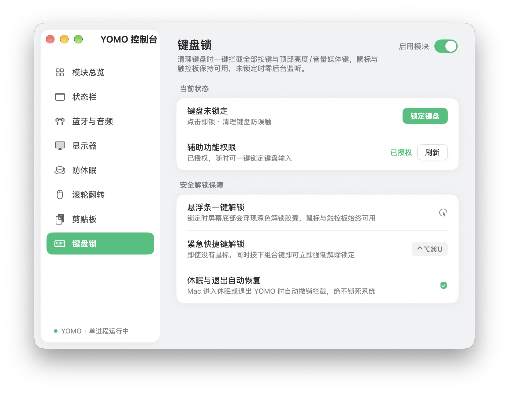
    </td>
    <td width="54%" valign="top">
      <p><b>Highlights</b></p>
      <ul>
        <li><b>Blocks All Keys &amp; Media Keys</b>: Uses a native Quartz <code>CGEventTap</code> to swallow all keyboard input plus top-row media/function keys (brightness, volume, playback) while keeping your mouse and trackpad fully usable.</li>
        <li><b>Fail-Safe Unlocking</b>: Unlock anytime via the floating bottom HUD pill, the YOMO popover button, or the emergency chord <code>⌃⌥⌘U</code>; automatically unlocks on Mac sleep or app exit.</li>
        <li><b>Zero Idle Overhead</b>: Completely tears down the event tap when unlocked (0% CPU) and shares Accessibility permission with Mouse Scroll Reverser.</li>
      </ul>
      <p><b>Example</b></p>
      <blockquote>
        Need to wipe down your MacBook keyboard—or keep a cat from typing across your open editor? Click the Keyboard Lock button in YOMO, clean freely, then click the bottom unlock HUD or press <code>⌃⌥⌘U</code>.
      </blockquote>
    </td>
  </tr>
</table>

---

### 8. Space Cleaner &amp; Startup Items

<table>
  <tr>
    <td width="46%" align="center">
      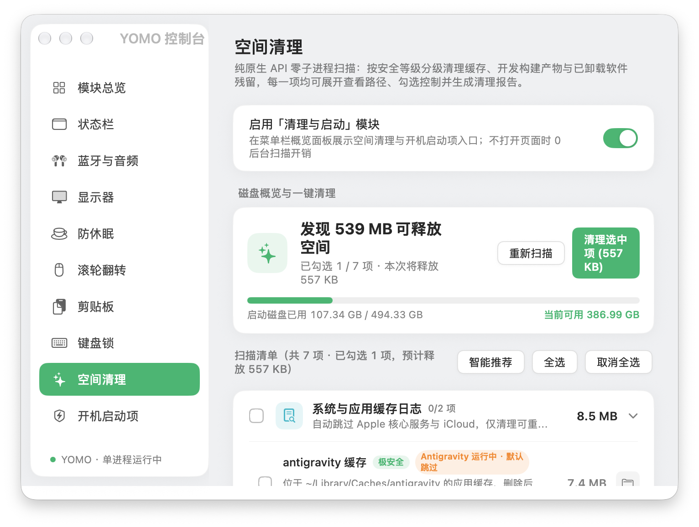
    </td>
    <td width="54%" valign="top">
      <p><b>Highlights</b></p>
      <ul>
        <li><b>Zero-Subprocess Tiered Space Cleaner</b>: Native API scanning for system/app caches, developer build artifacts, and uninstalled app leftovers—automatically guarding Apple core services and currently running apps, with expandable paths, per-item checkboxes, and a cleanup report.</li>
        <li><b>Grouped Startup Items Manager</b>: Groups <code>launchd</code> background items by app with real running status and app icons, reversible one-click toggles for user <code>LaunchAgents</code>, on-demand admin auth for system daemons, and direct links to macOS Login Items &amp; Extensions settings.</li>
        <li><b>On-Demand Scanning</b>: Zero background scanning when the cleaner page is closed.</li>
      </ul>
      <p><b>Example</b></p>
      <blockquote>
        Running low on SSD space or tired of mystery background updaters? Open YOMO Console → Space Cleaner → click Smart Select to safely reclaim cache &amp; leftover gigabytes, then switch to Startup Items to toggle unwanted background agents off by app.
      </blockquote>
    </td>
  </tr>
</table>

---

### Appearance & Customization

<table>
  <tr>
    <td width="38%" align="center">
      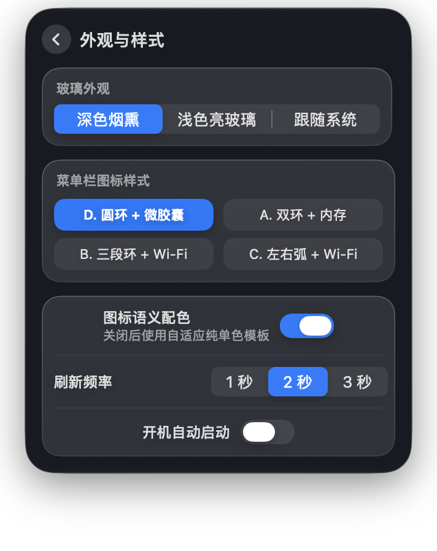
    </td>
    <td width="62%" valign="top">
      <ul>
        <li><b>Drag-and-Drop Bento Grid</b>: Reorder tiles directly at 120Hz in the popover, or enter Layout Mode to resize tiles (<code>1x / 2x / 4x</code>) with smart first-fit row packing.</li>
        <li><b>Three Glass Themes</b>: Switch live between <code>Dark Smoked</code>, <code>Light Frosted</code>, and <code>Follow System</code>.</li>
        <li><b>Badge Personalization</b>: Combine 4 menu bar badge layouts with semantic colors or monochrome templates.</li>
        <li><b>Refresh Cadence</b>: Choose <code>1s</code>, <code>2s</code>, or <code>3s</code> sampling intervals.</li>
        <li><b>Launch at Login &amp; Native In-Place Updater</b>: Native login item registration plus rate-limit-free GitHub Releases update checking and one-click in-place upgrades with SHA-256 verification.</li>
      </ul>
    </td>
  </tr>
</table>

---

## Quick Start

### Option 1: Download Release DMG (Recommended)

1. Download **`YOMO-v1.6.1.dmg`** from the [Releases page](https://github.com/vvkis/YOMO/releases) (clean **`YOMO-v1.6.1-source.zip`** and `SHA256SUMS.txt` are also provided).
2. Open the `.dmg` and drag **`YOMO.app`** into **`Applications`**.
3. Launch **YOMO**, open **Appearance & Style**, and enable **Launch at Login**.

> [!NOTE]
> **macOS Gatekeeper notice on first launch:**
> Because YOMO is free open-source software signed locally (not Apple-notarized), macOS may warn that the developer cannot be verified on first launch. Clear the quarantine attribute with one command:
> ```bash
> xattr -cr /Applications/YOMO.app
> ```

### Option 2: Build from Source

- **OS**: macOS 14.0 (Sonoma) or later (Apple Silicon & Intel)
- **Toolchain**: **Xcode Command Line Tools** (Swift 5.10+) — **full Xcode is not required**

Install Command Line Tools if needed:

```bash
xcode-select --install
```

Build, run, or package a release locally:

```bash
# 1. Clone the repository
git clone https://github.com/vvkis/YOMO.git
cd YOMO

# 2. Build Release binary and bundle YOMO.app
./scripts/build-app.sh
open dist/YOMO.app

# 3. (Optional) Build Release DMG + clean source ZIP + SHA256 checksums
./scripts/build-release.sh
# Outputs: dist/YOMO-v1.6.1.dmg, dist/YOMO-v1.6.1-source.zip, dist/SHA256SUMS.txt
```

### Permissions

YOMO is **100% offline** with zero telemetry or network calls. Optional macOS permissions are requested only when needed:

| Permission | Purpose | Required? |
| :--- | :--- | :--- |
| **Location Services** | macOS 14+ requires Location access to read the current Wi-Fi SSID and scan nearby networks | Optional (signal bars & network speeds still work without it) |
| **Bluetooth** | Read paired Bluetooth status, AirPods battery levels, and toggle connections | Only when using the Bluetooth module |
| **Accessibility** | Reverse external mouse wheel scrolling (leaves trackpad untouched) or lock keyboard input in Cleaning Mode | Only when using Mouse Scroll Reverser or Keyboard Lock |

---

## FAQ

<details>
<summary><b>1. Why does Wi-Fi show as connected without displaying the network name (SSID)?</b></summary>
<br />
Starting with macOS 14 (Sonoma), Apple classifies Wi-Fi SSIDs as location-sensitive data and returns <code>nil</code> unless Location permission is granted. Click <b>Authorize</b> inside YOMO's Wi-Fi page, or enable <b>YOMO</b> in <i>System Settings → Privacy &amp; Security → Location Services</i>.
</details>

<details>
<summary><b>2. Why doesn't building YOMO require the full Xcode app?</b></summary>
<br />
YOMO is structured as a pure Swift Package Manager project without dependencies on Xcode-only macro plugins, allowing fast compilation with just Command Line Tools.
</details>

<details>
<summary><b>3. Do disabled modules really have zero background overhead?</b></summary>
<br />
Yes. Turning off a module in <b>Hub Console → Modules</b> hides it from the popover and skips its refresh paths entirely; disabling KeepAwake also immediately releases any active sleep-prevention assertion.
</details>

<details>
<summary><b>4. How do I completely uninstall YOMO?</b></summary>
<br />
Disable <b>Launch at Login</b> in YOMO, quit the app, and move <code>/Applications/YOMO.app</code> to the Trash. To completely remove preferences, clipboard history data, and all caches as well:
<pre><code>defaults delete com.yomo.suite 2&gt;/dev/null || true
rm -rf \
  "$HOME/Library/Application Support/YOMO" \
  "$HOME/Library/Caches/com.yomo.suite" \
  "$HOME/Library/HTTPStorages/com.yomo.suite" \
  "$HOME/Library/Saved Application State/com.yomo.suite.savedState"</code></pre>
</details>

---

## Contributing

Issues, feature suggestions, and Pull Requests are warmly welcome!

## License

Licensed under the [MIT License](LICENSE).

<div align="center">
  <br />
  <sub>If YOMO made your Mac menu bar a little cleaner, consider leaving a ⭐ Star!</sub>
</div>
